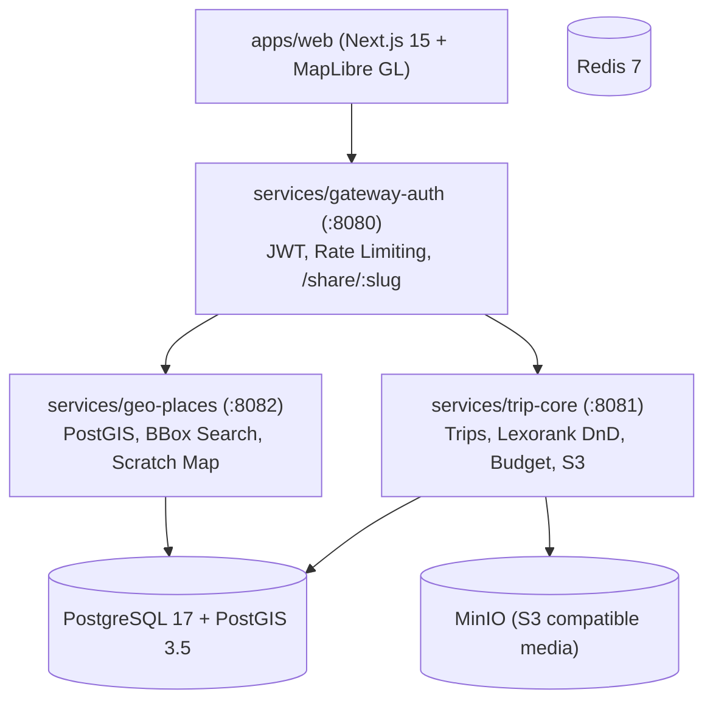

# AtlasFlow / NomadGlass MVP

> Personal travel scratch-map + day-by-day trip planner MVP built with Go 1.25+ Clean Architecture microservices and Next.js 15 (MapLibre GL + Adaptive Glass UI).

---

## 🎨 Interactive Figma Prototype

The interactive prototype has been authored and imported into Figma:
- **Figma File**: [AtlasFlow Figma Design & Interactive Preview](https://www.figma.com/design/Z4WaYJoVaUfceutv1nLgtq?node-id=3-3&autoplay-code-preview=3-3)

---

## 📐 Architecture Overview



### Directory Structure

```text
├── apps/
│   └── web/                     # Next.js 15, TailwindCSS, MapLibre GL, Zustand, TanStack Query
├── deploy/                      # docker-compose.yml (PostgreSQL + PostGIS, MinIO, Redis)
├── pkg/                         # Shared cross-cutting packages (logger, config, errors)
├── proto/                       # Protobuf schemas & generated ConnectRPC Go stubs
├── services/
│   ├── gateway-auth/            # JWT authentication, reverse proxy, public /share/:slug
│   ├── geo-places/              # PostGIS point & bbox spatial queries, traveler scratch-map stats
│   └── trip-core/               # Trip planner, lexorank DnD, budget tracker, checklists, S3 storage
├── go.work                      # Go workspace linking pkg, proto, and all services
└── Makefile                     # Build & run automation
```

---

## 🚀 Quick Start

### 1. Start Infrastructure (Docker Compose)

```bash
# Starts PostgreSQL 17 + PostGIS 3.5, MinIO (with atlasflow-media bucket), and Redis 7
docker compose -f deploy/docker-compose.yml --env-file deploy/.env.example up -d
```

### 2. Build & Test Go Microservices

```bash
# Run all unit and integration test suites
make test

# Compile all microservices into bin/
make build
```

This compiles:
- `bin/gateway-auth`
- `bin/trip-core`
- `bin/geo-places`

### 3. Run Frontend

```bash
cd apps/web
npm run dev
```

Open [http://localhost:3000](http://localhost:3000) in your browser:
- **World Scratch Map**: Click on countries to mark them visited, filter pins by status (`Visited`, `Planned`, `Wishlist`) and category (`Stay`, `Food`, `Sight`, `Nature`, `Transport`).
- **Trip Planner Workspace**: Toggle to Trip Mode to view day-by-day itineraries, drag-and-drop place reordering via string Lexoranks, budget breakdowns, and checklist readiness percentages.
- **Place Drawer**: Click any marker or search query to inspect notes, category, coordinates, and attachments.
- **Public Share View**: Access `/share/<slug>` for unauthenticated read-only guest viewing with private expenses and sensitive documents automatically stripped.

---

## 🔒 Public Share Privacy Guarantee

Public share links (`/share/:slug`) are strictly isolated:
1. Handled unauthenticated with rate-limiting at the gateway.
2. Filtered at the domain layer (`domain.SanitizeForPublic`):
   - **Trip budget limits and expenses are never sent to public clients**.
   - **Private attachments are completely excluded**; only attachments explicitly flagged as public are accessible.
   - User identity headers (`X-User-Id`, `X-User-Email`) are completely stripped on public endpoints to prevent identity spoofing.

---

## 🧪 Testing

```bash
# Run all Go tests
go test ./pkg/... ./proto/... ./services/gateway-auth/... ./services/geo-places/... ./services/trip-core/...

# Build Next.js application
cd apps/web && npm run build
```
