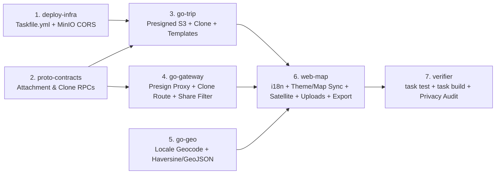

# AtlasFlow / NomadGlass — Release Specification `v0.2.0`

- **Version**: `v0.2.0` (SemVer `MINOR` Feature Release)
- **Status**: `RELEASE_LOCKED`
- **BA_APPROVED**: `yes` (`business-analyst`)
- **PM_APPROVED**: `yes` (`product-manager`)
- **Repository**: `/Users/makskozlov/pet` (`https://github.com/maks2134/Geo-Trip`)

---

## 1. Theme / Goal

### Theme: *"Global Nomad Experience — Multilingual Canvas, Adaptive Optics, Media Vault & Route Portability"*

AtlasFlow `v0.1.0` established the core Clean Architecture foundation (`gateway-auth`, `trip-core`, `geo-places`, `apps/web` MapLibre GL JS canvas, Lexorank DnD itinerary planning, and sanitized `/share/:slug` links).

**Goal of `v0.2.0`**: Elevate AtlasFlow from a technical MVP into an international, visually adaptive daily driver for travelers by delivering:
1. **Multilingual UI (`MH-A`)**: Full Russian (`ru`) and English (`en`) localization with ICU pluralization rules, zero hardcoded strings, and extensible dictionary architecture.
2. **Adaptive System Theme & Map Style Sync (`MH-B`)**: Automatic OS theme tracking (`prefers-color-scheme`) with manual `light`/`dark` override, keeping Adaptive Glass tokens and MapLibre vector styles in lockstep without losing active GeoJSON layers.
3. **MinIO Media Vault (`MH-C`)**: Direct browser-to-MinIO presigned PUT/GET uploads for trip cover photos, place photo galleries, and private PDF vouchers with strict MIME/size gating and `/share/:slug` privacy isolation.
4. **Satellite Map Basemap Toggle (`MH-D`)**: Instant `Streets ↔ Satellite` toggle in MapLibre GL JS with high-contrast route halos and automatic vector fallback.
5. **High-ICE Nomad Multipliers**: Pulling the highest-scoring ICE candidates into `v0.2.0` (**"Copy to My Trips" Fork CTA**, **Auto Day Distance & Travel Time Matrix**, **Packing List Starter Templates**, and **GPX / GeoJSON Route Export**), plus migrating developer automation from `Makefile` to **`Taskfile.yml`** (`OPS-1`).

---

## 2. Version Proposal (`product-manager`)

- **Proposed & Locked Version**: **`v0.2.0`**
- **SemVer Rationale**: Introduces backward-compatible user-facing capabilities across `apps/web`, `trip-core`, `geo-places`, and `gateway-auth` without breaking `v0.1.0` data contracts.

---

## 3. MUST-HAVE Features (`MH-A` – `MH-D` + `OPS-1`) — Full BA Specification

```
┌──────────────────────────────────────────────────────────────────────────────┐
│                          RELEASE v0.2.0 MUST-HAVES                           │
├─────────────────┬──────────────────┬─────────────────┬───────────────────────┤
│      MH-A       │       MH-B       │      MH-C       │         MH-D          │
│ Multilingual UI │  System Theme +  │  MinIO Photo    │   Satellite Basemap   │
│   (ru + en)     │  Map Style Sync  │  Presigned S3   │   Streets ↔ Satellite │
│   [Effort: M]   │   [Effort: M]    │   [Effort: L]   │      [Effort: S]      │
└─────────────────┴──────────────────┴─────────────────┴───────────────────────┘
```

---

### MH-A: Multilingual UI (`i18n` — `ru` + `en` + Extensible Locale Architecture)

#### 1. Problem / Job-to-be-Done
- **When** international digital nomads and bilingual travelers (specifically Russian and English speakers) use AtlasFlow to track visited countries or plan day-by-day trips,
- **They want** the entire UI chrome, traveler metrics, categories, and dialogs presented in their preferred language with grammatically accurate pluralization,
- **So that** they can plan trips intuitively without language barriers or layout overflow, while public trip links (`/share/:slug`) render localized UI chrome without altering the author's original trip titles or notes.

#### 2. User Stories
- **US-A1**: *As a Russian-speaking traveler*, I want to switch the UI language to Russian (`ru`), so that all navigation, categories, stats, and dialogs appear in my native language.
- **US-A2**: *As a traveler viewing counts of countries, cities, days, or places*, I want labels to follow exact Slavic and English pluralization rules (e.g., `"1 страна"`, `"3 страны"`, `"12 стран"`, `"1 день"`, `"4 дня"`, `"5 дней"`), so that the UI reads naturally.
- **US-A3**: *As a first-time visitor*, I want AtlasFlow to detect my browser language (`navigator.languages` / `Accept-Language`) automatically and fall back to `en` if unsupported.
- **US-A4**: *As a guest opening `/share/:slug`*, I want the viewer interface (`"День 1"`, `"Скопировать маршрут"`) in my own language while keeping the author's trip title and notes untouched.

#### 3. Acceptance Criteria (`Given / When / Then`)

##### Scenario A.1: First-visit language auto-detection & fallback
- **Given** a user visits AtlasFlow with no `atlasflow_locale` key in `localStorage`,
- **When** `navigator.languages` / `Accept-Language` prioritizes `ru` or `ru-RU`,
- **Then** the application initializes in Russian (`ru`), sets `<html lang="ru">`, and persists `atlasflow_locale="ru"`.
- **When** the browser reports an unsupported locale (e.g., `de-DE`, `ja-JP`),
- **Then** the application falls back safely to English (`en`).

##### Scenario A.2: Instant manual locale switch & persistence
- **Given** an authenticated user or guest on any map or trip screen,
- **When** the user toggles the language selector pill (`EN | RU`) in the floating glass dock,
- **Then** all UI labels, filter pills, drawer tabs, and tooltips update immediately without reloading the page or resetting the MapLibre camera position,
- **And** `localStorage` and cookie `atlasflow_locale` persist the selection across refreshes.

##### Scenario A.3: ICU pluralization rules (`one` / `few` / `many` / `other`)
- **Given** traveler stats or day headers rendering dynamic integer counts,
- **When** active locale is `ru`,
- **Then** plural helper (`Intl.PluralRules('ru')`) outputs:
  - `one` (1, 21, 31...): `"1 страна"`, `"21 день"`, `"1 место"`
  - `few` (2–4, 22–24...): `"2 страны"`, `"4 дня"`, `"3 места"`
  - `many` (0, 5–20, 25–30...): `"5 стран"`, `"12 дней"`, `"20 мест"`
- **When** active locale is `en`,
- **Then** plural helper outputs `"1 country"` vs `"5 countries"`, `"1 day"` vs `"12 days"`.

##### Scenario A.4: Zero hardcoded UI strings audit
- **Given** all `.tsx` components under `apps/web/src/` and `apps/web/app/`,
- **When** audited for static UI copy,
- **Then** zero hardcoded English/Russian UI literals exist in JSX markup; all copy resolves via typed dictionary keys (`apps/web/src/shared/i18n/locales/{en,ru}.json`).

##### Scenario A.5: Public share `/share/:slug` content isolation
- **Given** a public trip authored in English with title `"Kyoto Autumn Trail"` and place note `"Try matcha near entrance"`,
- **When** a Russian-speaking guest views `/share/:slug` with locale `ru`,
- **Then** all viewer chrome (`"День 1"`, `"Скопировать в мои поездки"`, `"Только чтение"`) renders in Russian,
- **And** `"Kyoto Autumn Trail"` and `"Try matcha near entrance"` remain verbatim in English.

#### 4. Scope & Service Impact
- **`apps/web`**: Typed dictionary files `src/shared/i18n/locales/en.json` and `ru.json`; ICU plural formatter; `Intl.DateTimeFormat` for trip dates; `Intl.DisplayNames([locale], { type: 'region' })` for ISO2 country names; glass dock `EN | RU` pill; flex/truncate guards for 25–35% longer Russian strings.
- **`gateway-auth` / `geo-places`**: Forward `Accept-Language` / `X-Atlas-Locale` to geocoder suggestions (`&accept-language=ru,en`).
- **`trip-core`**: Return machine-readable error codes (`ERR_ATTACHMENT_TOO_LARGE`, `ERR_UNAUTHORIZED`) mapped to localized toast messages on the client.
- **Effort**: `M`

---

### MH-B: System Theme (`prefers-color-scheme`) + Manual Override + Map Style Sync

#### 1. Problem / Job-to-be-Done
- **When** travelers use AtlasFlow across changing environments (bright outdoor sunlight vs night flights or dimly lit cafes),
- **They want** the UI and vector map canvas to follow their OS color scheme by default (`system`) with a manual `light` / `dark` override,
- **So that** glass panels and map tiles remain comfortable to read without losing active GeoJSON layers (visited country polygons, route polylines, numbered pins) during theme switches.

#### 2. User Stories
- **US-B1**: *As a user*, I want the app to default to `system` theme so it automatically switches between dark smoked glass and light frosted glass when my OS appearance changes.
- **US-B2**: *As an outdoor user in bright sunlight*, I want to manually override the theme to `light` (or `dark`) and have my choice remembered.
- **US-B3**: *As a planner viewing a multi-stop route*, I want the MapLibre vector style to switch between Dark and Light basemaps smoothly while keeping all my pins, polylines, and visited country fills intact.

#### 3. Acceptance Criteria (`Given / When / Then`)

##### Scenario B.1: Real-time OS `prefers-color-scheme` tracking
- **Given** theme preference is set to `system` (default),
- **When** `window.matchMedia('(prefers-color-scheme: dark)')` emits a change event,
- **Then** `<html data-theme="dark|light">` updates immediately, Adaptive Glass CSS variables transition, and MapLibre switches to the corresponding dark or light vector style.

##### Scenario B.2: Manual tri-state override & FOUC prevention
- **Given** the theme selector in the floating glass dock (`System` | `Light` | `Dark`),
- **When** the user selects `Light` or `Dark`,
- **Then** `localStorage.setItem('atlasflow_theme', mode)` persists the choice,
- **And** an inline `<head>` bootstrap script applies `data-theme` before first paint so dark-mode users never see a white flash (FOUC) on refresh.

##### Scenario B.3: GeoJSON layer preservation across MapLibre `styledata` / `style.load`
- **Given** an active map canvas displaying visited country polygons (`visited-countries-fill`), a day route (`route-polyline`), and numbered day pins (`numbered-pins`),
- **When** the theme switches from `dark` (Carto Dark Matter) to `light` (Carto Positron) via `map.setStyle(...)`,
- **Then** the declarative layer reconciler re-attaches all custom GeoJSON sources and layers on `style.load`,
- **And** all polygons, polylines, and pins remain visible at the exact same camera coordinates (`center`, `zoom`, `bearing`, `pitch`) with zero console errors.

##### Scenario B.4: Adaptive Glass & pin contrast compliance
- **Given** `data-theme="dark"`, panels use `--glass: rgba(17, 23, 34, 0.78)`, `--glass-border: rgba(255, 255, 255, 0.09)`, `--text: #F8FAFC`.
- **Given** `data-theme="light"`, panels use `--glass: rgba(255, 255, 255, 0.82)`, `--glass-border: rgba(15, 23, 42, 0.08)`, `--text: #0F172A`.
- **And** category pins (`food`, `stay`, `sight`, `nature`, `transport`) render with adaptive halo strokes maintaining ≥ 4.5:1 WCAG AA contrast on both basemaps.

#### 4. Scope & Service Impact
- **`apps/web`**: `themeStore` (`system | light | dark`), inline FOUC-prevention script in `app/layout.tsx`, `useMapLayerReconciler` hook in `src/shared/map/`, configurable `NEXT_PUBLIC_MAP_STYLE_DARK` and `NEXT_PUBLIC_MAP_STYLE_LIGHT`.
- **Backend services**: Zero changes required.
- **Effort**: `M`

---

### MH-C: MinIO Photo Uploads (Trip Cover, Place Photos & Vouchers) via Presigned URLs

#### 1. Problem / Job-to-be-Done
- **When** travelers curate trips and places,
- **They want** to upload cover photos, place photo galleries, and PDF booking vouchers directly to object storage via presigned URLs,
- **So that** their workspace has rich visual context and offline-ready documents without streaming binary payloads through Go services, while keeping private documents strictly hidden on public `/share/:slug` pages.

#### 2. User Stories
- **US-C1**: *As a trip owner*, I want to upload a cover image for my trip card and workspace header via drag-and-drop.
- **US-C2**: *As a traveler*, I want to attach multiple photos (`jpeg`, `png`, `webp`) to a place in the Place Drawer and view them in a glass lightbox carousel.
- **US-C3**: *As a traveler*, I want to upload private PDF vouchers (flights, hotel bookings) up to 25 MB to a place or trip.
- **US-C4**: *As a trip owner sharing `/share/:slug`*, I want public photos (`visibility = 'public'`) displayed to guests while private photos/PDFs (`visibility = 'private'`) are completely stripped at the backend query boundary.

#### 3. Acceptance Criteria (`Given / When / Then`)

##### Scenario C.1: Presigned PUT URL generation & validation
- **Given** an authenticated user who owns trip `T`,
- **When** the client requests `CreateAttachmentUpload` with `{ trip_id: T, owner_type: "trip_cover" | "place", owner_id: P, file_name: "kyoto.webp", mime_type: "image/webp", size_bytes: 4194304, visibility: "public" }`,
- **Then** `trip-core` verifies `trip.OwnerID == userID`, validates the MIME type against the allowlist and size limit:
  - Photos (`image/jpeg`, `image/png`, `image/webp`): max **10 MB** (`10,485,760` bytes)
  - Documents (`application/pdf`): max **25 MB** (`26,214,400` bytes)
- **And** creates an `AttachmentMeta` row (`status = 'pending'`) with object key `trips/{trip_id}/{owner_type}/{owner_id}/{uuid}.{ext}`,
- **And** returns a 15-minute presigned `PUT` URL signed against `S3_PUBLIC_ENDPOINT` (`http://localhost:9000` for browser access).

##### Scenario C.2: Rejection of invalid MIME or oversized files
- **Given** an upload request with `mime_type: "video/mp4"`, `"application/x-msdownload"`, or an image > 10 MB (or PDF > 25 MB),
- **When** `CreateAttachmentUpload` is called,
- **Then** `trip-core` returns `400 Bad Request` (`ERR_ATTACHMENT_MIME_NOT_ALLOWED` or `ERR_ATTACHMENT_SIZE_EXCEEDED`), and no MinIO URL or DB record is created.

##### Scenario C.3: Direct browser-to-MinIO upload & confirmation
- **Given** a valid presigned `PUT` URL,
- **When** the browser uploads the binary directly to MinIO (`PUT` with `Content-Type` header) and calls `ConfirmAttachmentUpload(attachment_id)`,
- **Then** `trip-core` verifies the object exists in MinIO (`HeadObject`), transitions `status` from `pending` to `ready`, and returns a presigned/public `GET` URL.

##### Scenario C.4: Airtight `/share/:slug` privacy enforcement
- **Given** a trip with 2 public place photos (`visibility = 'public'`), 1 private place photo (`visibility = 'private'`), and 1 hotel voucher PDF (`visibility = 'private'`),
- **When** an unauthenticated guest requests `GET /share/:slug` (or clones the trip),
- **Then** the response payload contains **only** the 2 public photos with `status = 'ready'`,
- **And** zero metadata, storage keys, or URLs for private attachments are ever serialized in the network response.

#### 4. Scope & Service Impact
- **`deploy/`**: MinIO init container (`mc`) creates bucket `atlasflow-media`, sets CORS for `PUT, GET, HEAD` from web origin.
- **`proto/`**: RPCs `CreateAttachmentUpload`, `ConfirmAttachmentUpload`, `ListAttachments`, `DeleteAttachment`.
- **`services/trip-core`**: `domain/attachment.go` validation rules; `adapter/storage/minio.go` with internal (`minio:9000`) + public (`localhost:9000`) signer; `attachments` Postgres migration.
- **`apps/web`**: Glass dropzone with progress bar, Trip cover banner uploader, Place Drawer thumbnail strip + fullscreen glass lightbox, PDF voucher row with `Private` lock badge.
- **Effort**: `L`

---

### MH-D: Satellite Map Basemap Toggle (`Streets ↔ Satellite`)

#### 1. Technical Feasibility Assessment
- **Feasible in MapLibre GL JS**: Yes. Rather than tearing down the vector style on toggle, `MapCanvas` injects a raster tile source (`type: 'raster'`, `tileSize: 256`) using `NEXT_PUBLIC_SATELLITE_TILE_URL` (defaulting to Esri World Imagery `https://server.arcgisonline.com/ArcGIS/rest/services/World_Imagery/MapServer/tile/{z}/{y}/{x}` with required `Tiles © Esri` attribution, or optional MapTiler Satellite key) positioned **below** the custom GeoJSON vector layers (`visited-countries-fill`, `route-polyline`, `numbered-pins`).
- **Fallback Strategy**: If ≥ 3 consecutive satellite tile requests fail (`error` event on source due to offline network or rate limiting), `MapCanvas` automatically hides the satellite raster layer, falls back to the active `Streets` vector basemap, and shows a localized non-blocking toast (`t('map.satellite_fallback')`).

#### 2. User Stories
- **US-D1**: *As a traveler scouting beaches, trails, or viewpoints*, I want a one-click `Streets | Satellite` toggle pill on the map canvas so I can inspect real terrain imagery.
- **US-D2**: *As a user in Satellite mode*, I want route polylines and visited country polygons to adjust their contrast and opacity so they remain clearly visible over dark forests, oceans, or bright desert imagery.
- **US-D3**: *As a user with an unstable connection*, I want the map to gracefully fall back to vector streets if satellite tiles cannot load.

#### 3. Acceptance Criteria (`Given / When / Then`)

##### Scenario D.1: Instant Streets ↔ Satellite toggle
- **Given** the user is viewing either the World Scratch Map or Trip Planner workspace,
- **When** the user clicks the `Satellite` toggle pill in the floating map controls dock,
- **Then** the satellite raster layer fades in (`raster-opacity: 1` over 300ms) beneath all custom GeoJSON layers without resetting camera zoom/center,
- **And** `localStorage.setItem('atlasflow_basemap', 'satellite')` persists the choice.

##### Scenario D.2: High-contrast overlay adaptation over satellite imagery
- **Given** `basemap === 'satellite'`,
- **When** visited country polygons and trip routes are rendered,
- **Then** `visited-countries-fill` opacity adjusts from `0.40` to `0.22` with a crisp `1.5px` `#FACC15` outline so terrain remains visible underneath,
- **And** `route-polyline` renders with a `2px` dark outer casing (`rgba(0,0,0,0.75)`) beneath the `#38BDF8` inner line so routes never disappear over bright terrain.

##### Scenario D.3: Automatic fallback on tile load failure
- **Given** `basemap === 'satellite'`,
- **When** satellite tile requests fail 3+ times with network/HTTP errors (429/503/offline),
- **Then** the map automatically reverts `basemap` to `'streets'`, hides the failed raster layer, and displays a localized toast notification.

#### 4. Scope & Service Impact
- **`apps/web`**: `basemap: 'streets' | 'satellite'` in Zustand map store; raster source/layer injection + error listener in `MapCanvas`; `NEXT_PUBLIC_SATELLITE_TILE_URL` in `.env.example` and `docker-compose.yml`.
- **Effort**: `S`

---

### OPS-1: Dev/Ops Migration from `Makefile` to `Taskfile.yml`

- **Rule Compliance**: Per `.agents/AGENTS.md` (*"Task runner: **Taskfile.yml** (`task`), never add Makefile targets"*).
- **Acceptance Criteria**:
  - **Given** the repository root `/Users/makskozlov/pet`,
  - **When** `Taskfile.yml` (v3) is created and `Makefile` is removed,
  - **Then** `task test`, `task build`, `task up`, `task down`, `task proto`, `task lint`, and `task dev:web` execute cleanly across Go services, Docker Compose, and Next.js.

---

## 4. ICE Scoring of 10 Candidate Features & `v0.2.0` Selection

Each candidate feature was evaluated by BA and scored by PM using **ICE**:
$$\text{ICE Score} = \frac{\text{Impact } (1\text{–}10) \times \text{Confidence } (1\text{–}10)}{\text{Effort } (S=4,\; M=5,\; L=7.5)}$$

| Rank | ID | Feature Title | Impact | Confidence | Effort | ICE Score | `v0.2.0` Decision |
| :---: | :---: | :--- | :---: | :---: | :---: | :---: | :--- |
| **1** | **CAND-10** | **"Copy to My Trips" Fork CTA on Public Share Links** | 8 | 9 | S (4) | **18.0** | **SELECTED FOR v0.2.0** |
| **2** | **CAND-01** | **Auto-Calculated Day Distance & Travel Time Matrix** | 9 | 9 | M (5) | **16.2** | **SELECTED FOR v0.2.0** |
| **3** | **CAND-06** | **Pre-Trip Packing List Starter Templates** | 7 | 9 | S (4) | **15.8** | **SELECTED FOR v0.2.0** |
| **4** | **CAND-08** | **GPX / GeoJSON Route & Pins Export** | 6 | 9 | S (4) | **13.5** | **SELECTED FOR v0.2.0** |
| 5 | CAND-02 | Country Visit Timeline & Scratch History Filter (Year Scrubber) | 7 | 9 | S (4) | 15.8 | Parked (`v0.3.0` Scratch theme) |
| 6 | CAND-05 | Multi-Currency Trip Expenses with Base FX Conversion | 8 | 9 | M (5) | 14.4 | Parked (`v0.3.0` Budget theme) |
| 7 | CAND-04 | Multi-Day Batch Place Allocation (Backlog Distribute) | 8 | 8 | M (5) | 12.8 | Parked (`v0.3.0`) |
| 8 | CAND-07 | Printable Offline Itinerary (Clean 1-Page/Day PDF Export) | 7 | 8 | M (5) | 11.2 | Parked (`v0.3.0`) |
| 9 | CAND-09 | Place Opening Hours & Day-of-Week Schedule Checker | 7 | 7 | M (5) | 9.8 | Parked (`v0.4.0`) |
| 10 | CAND-03 | Regional Subdivision Scratching (States / Provinces / Oblasts) | 9 | 8 | L (7.5) | 9.6 | Parked (`v0.4.0` PostGIS `admin_1`) |

---

### Specifications for Selected Additional Features in `v0.2.0`

#### 1. `CAND-10`: "Copy to My Trips" Fork CTA on Public Share Links (`ICE: 18.0`)
- **User Story**: *As an authenticated user viewing a shared itinerary at `/share/:slug`*, I want to click `"Copy to My Trips"` (`"Скопировать в мои поездки"`) so that a deep copy of the trip, days, and ordered places is created in my own workspace.
- **Acceptance Criteria (`Given / When / Then`)**:
  - **Given** a valid public share slug `/share/:slug`,
  - **When** an authenticated user clicks `"Copy to My Trips"`,
  - **Then** `gateway-auth` calls `trip-core.ClonePublicTrip(slug, userID)`, which creates a new `Trip` owned by `userID` with cloned `Days` and `PlaceItems` (preserving Lexorank order and public notes, while **excluding** the original owner's budget, expenses, checklists, and private attachments),
  - **And** the browser navigates to the newly cloned trip in the user's Trip Planner workspace.
  - **When** an unauthenticated guest clicks `"Copy to My Trips"`,
  - **Then** the UI prompts them to sign in / register and preserves the return action.

#### 2. `CAND-01`: Auto-Calculated Day Distance & Travel Time Matrix (`ICE: 16.2`)
- **User Story**: *As a trip planner ordering stops within a day*, I want to see the distance (km) and estimated travel time (walk / drive) between consecutive stops and the day's total distance, so that I avoid unrealistic backtracking.
- **Acceptance Criteria (`Given / When / Then`)**:
  - **Given** a day containing $\ge 2$ ordered places with valid `lat/lng` coordinates,
  - **When** the day timeline renders or items are reordered via Lexorank DnD,
  - **Then** each leg between stop $i$ and stop $i+1$ displays a compact glass connector badge (`"1.8 km • ~22 min walk"` for $< 2.5\text{ km}$ or `"8.4 km • ~15 min drive"` for $\ge 2.5\text{ km}$),
  - **And** the Day Header displays the summed total route distance (`"Total: 14.2 km"`).

#### 3. `CAND-06`: Pre-Trip Packing List Starter Templates (`ICE: 15.8`)
- **User Story**: *As a traveler preparing a checklist*, I want to one-click load curated starter templates (`"Digital Nomad Essentials"`, `"Beach & Sun"`, `"Mountain & Trekking"`, `"Winter City Break"`) into my checklist sections (`pre_flight`, `packing`, `buy_on_site`), so I don't start from a blank list.
- **Acceptance Criteria (`Given / When / Then`)**:
  - **Given** the Checklists tab in a trip workspace,
  - **When** the user selects a starter template (localized in `en` / `ru`) and clicks `"Apply Template"`,
  - **Then** categorized checklist items are added without duplicating existing items of the same title, and the trip readiness percentage updates immediately.

#### 4. `CAND-08`: GPX & GeoJSON Route Export (`ICE: 13.5`)
- **User Story**: *As an outdoor or road-trip traveler*, I want to export my trip or active day itinerary as a standard `.gpx` or `.geojson` file so I can open it offline in Organic Maps, OsmAnd, Garmin, or Google Earth.
- **Acceptance Criteria (`Given / When / Then`)**:
  - **Given** a trip with ordered day places,
  - **When** the user clicks `"Export Route"` → `"GPX (.gpx)"` or `"GeoJSON (.geojson)"`,
  - **Then** the browser downloads a valid GPX 1.1 file (`<wpt>` + `<rte>`) or RFC 7946 GeoJSON `FeatureCollection` containing `Point` features and the ordered `LineString` route.

---

## 5. Backlog (Parked for `v0.3.0+`)

1. **`CAND-02`**: Country Visit Timeline & Scratch History Filter (Year scrubber on World Scratch Map)
2. **`CAND-05`**: Multi-Currency Trip Expenses with Base FX Conversion
3. **`CAND-04`**: Multi-Day Batch Place Allocation (Bulk assign from Backlog)
4. **`CAND-07`**: Printable 1-Page/Day PDF Itinerary Export
5. **`CAND-09`**: Place Opening Hours & Day-of-Week Schedule Conflict Warning
6. **`CAND-03`**: Regional Subdivision Scratching (`admin_1` States / Provinces / Oblasts in PostGIS)

---

## 6. Out of Scope (Explicit Anti-Scope)

Per `.agents/GEMINI.md` and `.agents/skills/atlasflow-mvp/SKILL.md`, the following are strictly excluded:
- Realtime multiplayer co-editing, WebSockets/CRDT cursors, or chat.
- Social network feeds, public user directories, followers, likes, or comments.
- AI itinerary generation / LLM auto-planners.
- Self-hosted global vector/raster tile servers.
- Machine translation of user-authored notes or titles.
- Video file uploads or server-side media transcoding pipelines.

---

## 7. Dependencies & Risks

| Dependency / Risk | Severity | Owner | Mitigation |
| :--- | :---: | :---: | :--- |
| **MinIO Internal vs Browser Presigned Hostname** | High | `go-trip`, `deploy-infra` | Sign presigned PUT/GET URLs using `S3_PUBLIC_ENDPOINT` (`http://localhost:9000`) while internal health/bucket checks use `S3_INTERNAL_ENDPOINT` (`http://minio:9000`). Configure bucket CORS for web origin. |
| **MapLibre `setStyle()` Wiping Custom GeoJSON Layers** | High | `web-map` | Centralize GeoJSON source/layer creation inside a `syncCustomLayers(map)` callback bound to `map.on('style.load')` and state updates. |
| **Satellite Tile Attribution & Rate Limits** | Medium | `web-map` | Default `NEXT_PUBLIC_SATELLITE_TILE_URL` to Esri World Imagery with visible `Tiles © Esri` attribution; support custom MapTiler/Mapbox raster URLs via env var; auto-fallback to vector `Streets` after 3 tile load errors. |
| **Next.js Hydration Mismatch on Locale / Theme** | Medium | `web-map` | Inject synchronous pre-paint `<script>` for `data-theme` and initialize locale state cleanly with deterministic SSR fallback (`en`). |
| **Public Share Data Leak via Attachments or Clone** | Critical | `go-trip`, `go-gateway` | Enforce `visibility = 'public' AND status = 'ready'` at SQL query level in `GetPublicTripBySlug` and `ClonePublicTrip`. Never copy expenses or private attachments when cloning. |

---

## 8. Implementation Tracks (Engineering Handoff Brief)



| Track | Subagent | Exclusive Ownership Path | Deliverables |
| :--- | :--- | :--- | :--- |
| **Track 1** | `deploy-infra` | `Taskfile.yml`, `Makefile` (delete), `deploy/`, `docker-compose.yml` | Create `Taskfile.yml` replacing `Makefile`; configure MinIO bucket `atlasflow-media` with CORS and public endpoint env vars (`S3_ENDPOINT`, `S3_PUBLIC_ENDPOINT`, `S3_BUCKET`); add `deploy/init-db/` migration for `attachments` table and `trips.cover_url`. |
| **Track 2** | `proto-contracts` | `proto/` | Add attachment presign/confirm/delete messages & RPCs and `ClonePublicTrip` to `proto/trip/v1/trip.proto` (+ generated stubs). |
| **Track 3** | `go-trip` | `services/trip-core/` | Implement `AttachmentMeta` domain + MIME/size validation (`jpeg/png/webp` ≤10MB, `pdf` ≤25MB), S3/MinIO presigned PUT/GET adapter, `ClonePublicTrip` usecase, checklist template seeding, and table-driven unit tests. Ensure `GetPublicTrip` filters `visibility = 'public'` attachments only. |
| **Track 4** | `go-gateway` | `services/gateway-auth/` | Expose REST/BFF routes for attachment presign/confirm/delete, `POST /api/v1/share/{slug}/clone`, forward `Accept-Language`, and enforce `/share/{slug}` sanitization (strip budget, expenses, private attachments). |
| **Track 5** | `go-geo` | `services/geo-places/` | Forward locale hint (`Accept-Language`) in geocoder suggestions; expose distance calculation helper; ensure unit tests pass. |
| **Track 6** | `web-map` | `apps/web/` | Implement **MH-A** (`en`+`ru` dictionaries, ICU plurals, zero hardcoded strings, `/share/:slug` localized chrome), **MH-B** (`system/light/dark` theme + MapLibre vector style sync + layer preservation), **MH-C** (MinIO presigned photo/PDF uploader, trip cover, place gallery lightbox), **MH-D** (`Streets ↔ Satellite` raster toggle + fallback), plus **CAND-10** (Copy to My Trips CTA), **CAND-01** (Day leg distance/time badges), **CAND-06** (Checklist starter templates), and **CAND-08** (GPX/GeoJSON export). |
| **Track 7** | `verifier` | Read-only verification | Run `task test`, `task build`, Next.js production build, Clean Architecture import check, zero hardcoded UI string check, and `/share/:slug` privacy verification. |

---

## 9. Approvals

```yaml
BA_APPROVED: yes
PM_APPROVED: yes
status: RELEASE_LOCKED
version: v0.2.0
locked_at: 2026-11-09
```

---

## 10. Changelog Draft (`v0.2.0`)

```markdown
## [v0.2.0] — Global Nomad Experience

### Added
- **Multilingual UI (`ru` + `en`)**: Full Russian and English localization with ICU pluralization rules (`one`/`few`/`many`/`other`), automatic browser locale detection, persistent language switcher in the glass dock, and localized viewer chrome on `/share/:slug` that preserves user-authored trip content.
- **Adaptive System Theme & Map Style Sync**: Tri-state theme engine (`system` | `light` | `dark`) syncing OS `prefers-color-scheme`, Adaptive Glass CSS tokens (smoked vs. frosted glass), and MapLibre GL vector basemaps while preserving custom GeoJSON layers across style transitions.
- **MinIO Presigned Media Uploads**: Direct browser-to-MinIO presigned `PUT`/`GET` upload pipeline in `trip-core` for trip cover banners, place photo galleries, and private PDF vouchers with strict MIME/size validation (`jpeg`/`png`/`webp` ≤ 10 MB, `pdf` ≤ 25 MB).
- **Satellite Basemap Toggle (`Streets ↔ Satellite`)**: High-resolution satellite raster layer toggle in MapLibre GL with contrast-halo route polylines, adaptive country fill opacity, and automatic fallback to vector streets on tile failure.
- **"Copy to My Trips" Fork CTA**: One-click itinerary cloning from any public `/share/:slug` link into the authenticated user's workspace.
- **Day Distance & Travel Time Matrix**: Automatic per-leg Haversine distance and walking/driving duration estimates between consecutive stops in the Day Timeline.
- **Packing List Starter Templates**: Localized one-click checklist templates (*Digital Nomad Essentials*, *Beach & Sun*, *Mountain & Trekking*, *Winter City Break*).
- **GPX & GeoJSON Route Export**: Export trip or day routes to `.gpx` (GPX 1.1) and `.geojson` (RFC 7946) for offline navigation apps.

### Changed
- **Taskfile Automation**: Migrated repository task runner from `Makefile` to `Taskfile.yml` (`task test`, `task build`, `task up`, `task down`, `task dev:web`).

### Security & Privacy
- Enforced strict `visibility = 'public'` filtering on `/share/:slug` and `ClonePublicTrip` so private PDF vouchers, private photos, and trip budgets are never exposed to guests.
```

---

## 11. Ship Checklist (`release-ship`)

Execute only when all `v0.2.0` engineering tracks and `verifier` checks are green (or when explicitly instructed to ship):

- [x] `BA_APPROVED: yes` and `PM_APPROVED: yes` recorded in `docs/releases/v0.2.0.md`
- [x] Release status set to `RELEASE_LOCKED`
- [ ] All engineering tracks (`deploy-infra`, `proto-contracts`, `go-trip`, `go-gateway`, `go-geo`, `web-map`) implemented
- [ ] `verifier` confirms `task test`, `task build`, and `apps/web` build are 100% green
- [ ] Verify no `.env` secrets or credentials are staged (`git status`)
- [ ] Commit changes without AI signature (`git commit --no-gpg-sign`)
- [ ] Push branch to GitHub (`git push -u origin main`)
- [ ] Create annotated semver tag: `git tag -a "v0.2.0" -m "AtlasFlow v0.2.0 — Global Nomad Experience"`
- [ ] Push tag to GitHub: `git push origin "v0.2.0"`
- [ ] Publish GitHub Release: `gh release create "v0.2.0" --title "v0.2.0 — Global Nomad Experience" --notes-file docs/releases/v0.2.0.md`
